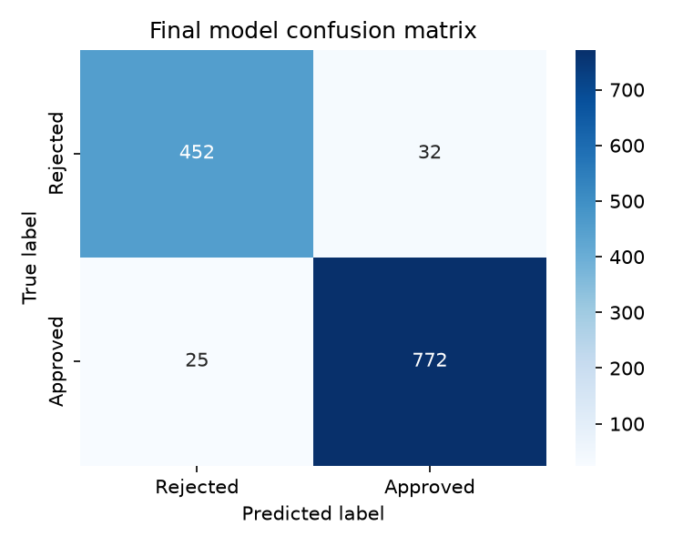
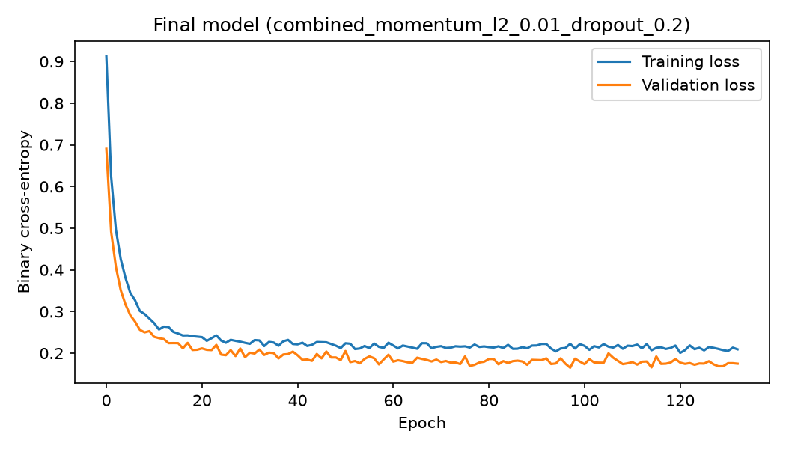

# Loan Approval Prediction using a Multilayer Perceptron (MLP)

A neural network that predicts whether a loan application will be **Approved** or **Rejected** from applicant data, with an interactive **Streamlit** web app for trying predictions.

Course project for **STINK3014 Neural Networks**, Universiti Utara Malaysia (UUM).

> Educational demonstration only. The predictions reflect patterns in historical data, may be biased, and must not be used as the basis for a real credit decision.

## Results

Final model evaluated once on a held-out test set (30% of the data, stratified):

| Metric | Score |
|---|---|
| Accuracy | 95.6% |
| Precision | 96.0% |
| Recall | 96.9% |
| F1-score | 96.4% |
| ROC-AUC | 0.994 |

| Confusion matrix | Training vs validation loss |
|---|---|
|  |  |

## Model

- **Architecture:** Dense(32, ReLU) → Dropout(0.2) → Dense(16, ReLU) → Dropout(0.2) → Dense(1, Sigmoid)
- **Optimizer:** SGD with momentum (0.9), learning rate 0.01, batch size 32
- **Regularisation:** L2 (0.01) + Dropout (0.2)
- **Training:** binary cross-entropy, early stopping on validation loss (patience 35)
- **Framework:** TensorFlow / Keras

## Dataset and preprocessing

- 4,269 loan applications, 11 input features (dependents, education, self-employment, annual income, loan amount, loan term, CIBIL score, and four asset values), target `loan_status` (Approved / Rejected).
- Exact duplicates and the `loan_id` identifier removed; categorical features encoded as 0/1.
- Stratified 70% development / 30% held-out test split; a validation set is taken from the development portion.
- `StandardScaler` fitted on the training data only, then applied to validation and test data (no data leakage).
- The dataset file is not included in this repository. Place `loan_approval_dataset.csv` in the project root to re-run the training script.

## Experiments

All experiments are in `solution.py`, with results saved as CSV files and plots in `outputs/`.

1. **Baseline:** (32, 16) network with Adam.
2. **Optimizer comparison:** SGD, Momentum, Adagrad, RMSprop, Adam. Adam gave the best validation scores (F1 0.981, ROC-AUC 0.997); Adagrad was clearly the weakest. See `outputs/optimizer_comparison.csv`.
3. **Hyperparameter tuning:** 8 configurations varying hidden layers, optimizer, learning rate and batch size. See `outputs/hyperparameter_tuning.csv`.
4. **Regularisation:** none vs L1 vs L2 vs Elastic Net, at strengths 0.01 and 0.5. Light regularisation (0.01) kept performance strong, while 0.5 over-regularised the network until it only predicted the majority class (about 62% accuracy). See `outputs/regularisation_comparison.csv`.
5. **Dropout:** rates 0.0, 0.2 and 0.5. A rate of 0.2 gave the lowest validation loss. See `outputs/dropout_comparison.csv`.
6. **Final model:** momentum SGD + L2 + dropout 0.2, evaluated once on the held-out test set.

## Run it locally

Python 3.11 is recommended.

```bash
python -m venv .venv
# Windows:
.venv\Scripts\activate
# macOS/Linux:
source .venv/bin/activate

pip install -r requirements.txt

# Optional: re-run all experiments (needs loan_approval_dataset.csv in this folder, takes several minutes)
python solution.py

# Launch the web app (uses the trained model already saved in outputs/)
streamlit run app.py
```

## Project structure

```
├── app.py                 # Streamlit prediction interface
├── solution.py            # Data preparation, experiments and final model training
├── requirements.txt
└── outputs/
    ├── best_model.keras   # Trained model
    ├── scaler.joblib      # Fitted StandardScaler
    ├── feature_columns.json
    ├── final_metrics.json
    └── *.csv, *.png       # Experiment results and plots
```

## Limitations

- The data comes from a single dataset and may not represent real lending populations.
- A wrong prediction has real costs in lending: false approvals risk losses, and false rejections unfairly turn away good applicants.
- No fairness analysis was performed across applicant groups; the model should not be used for real decisions.

## Author

**Salem Saleh Mathabq** · IT undergraduate (AI minor), UUM
[LinkedIn](https://www.linkedin.com/in/salem-matbhaq-769310402) · salemmatbak@gmail.com
